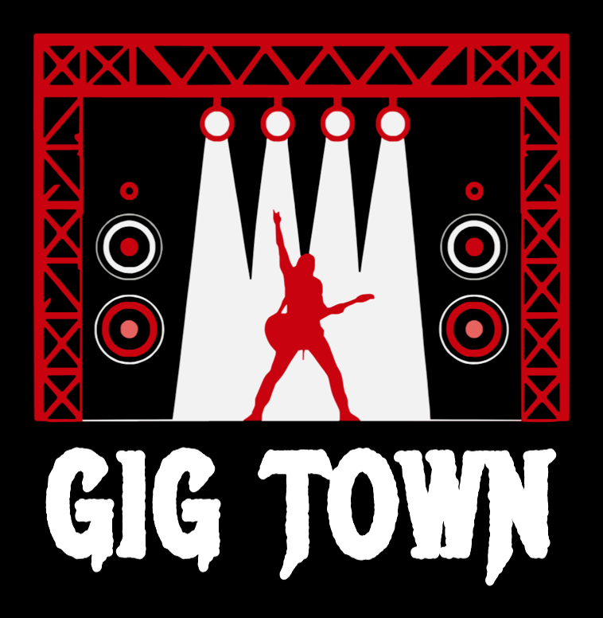
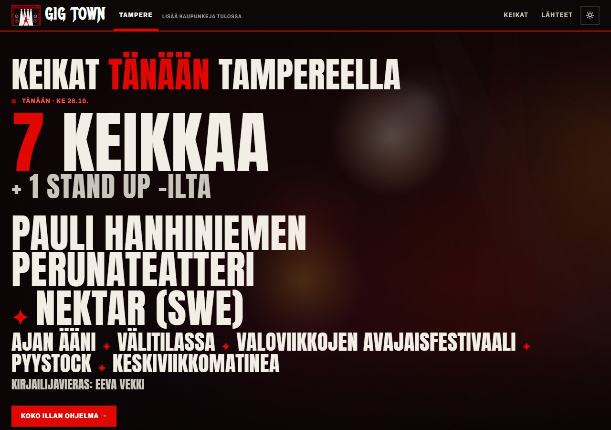
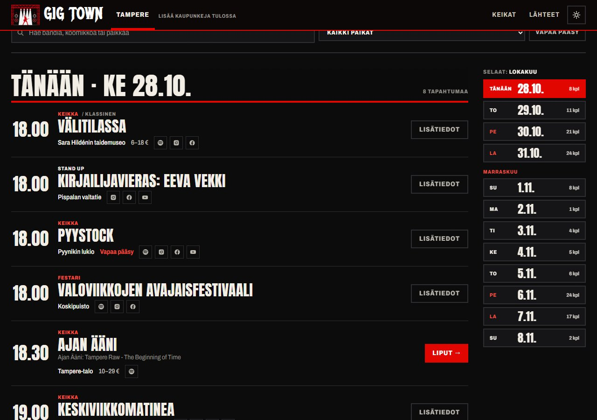
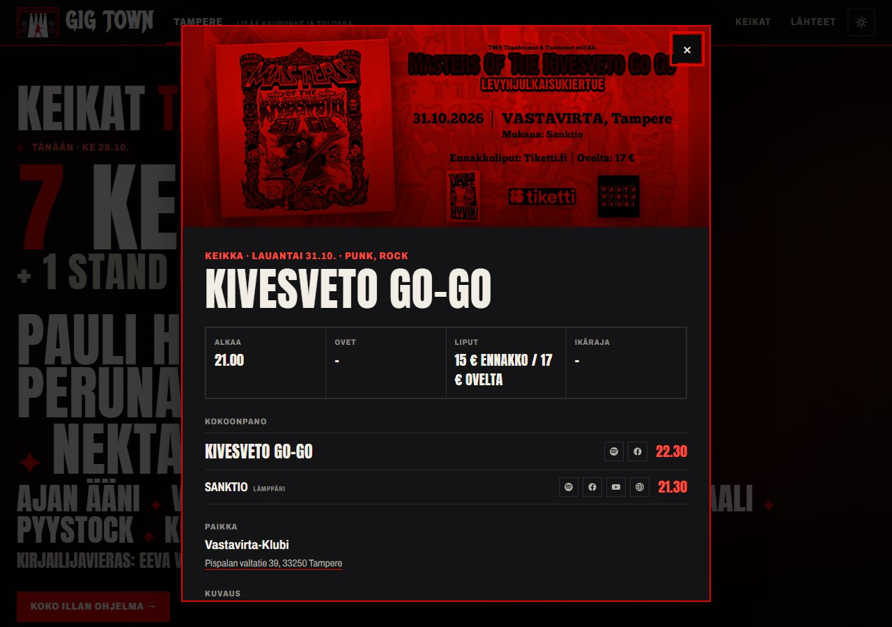
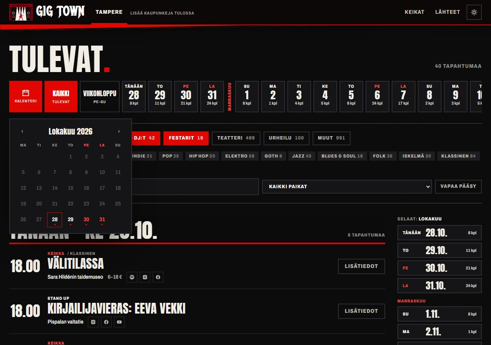
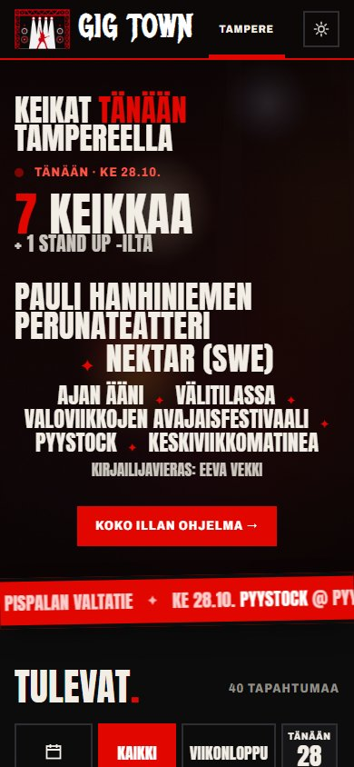
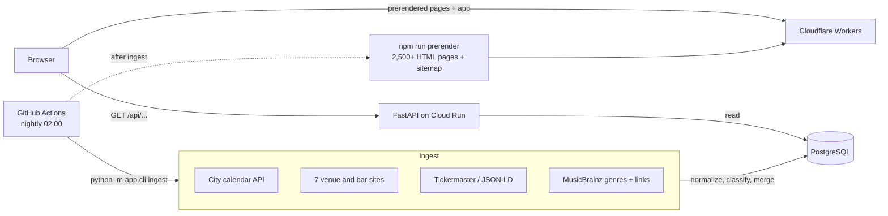

<div align="center">



### Every gig in Tampere on one page.

Concerts, club nights, stand-up and small bar gigs, collected every night by
bots from public calendars and venue websites, merged, sorted by genre and
shown by date: line-ups, set times, doors, prices and ticket links.

**Live: [gigtown.fi](https://gigtown.fi)**

[Features](#features) · [Sources](#sources) · [How it works](#architecture) · [Engineering decisions](#engineering-decisions) · [Source code](#source-code)


</div>

> **Lyhyesti suomeksi:** GigTown kokoaa kaikki Tampereen keikat, klubit,
> stand up -illat ja tapahtumat yhdelle sivulle. Botit käyvät joka yö klo 2
> läpi kaupungin tapahtumakalenterin ja 12 keikkapaikan sivut, yhdistävät
> saman keikan eri lähteistä, tunnistavat lämppärit, soittoajat, ovien
> aukeamisen ja hinnat, hakevat bändeille genret ja Spotify-/somelinkit, ja
> rakentavat jokaiselle päivälle, paikalle ja tapahtumalle oman
> hakukoneystävällisen sivun ("Keikat tänään Tampereella").



## Why

Gigs in Tampere are spread over a dozen places: the city's event calendar,
three ticket shops and every venue's own website, and the small bar gigs
with free entry or door tickets are only on the venue's page or its Facebook
event. Finding out "what's on tonight" means opening ten tabs.

GigTown does that once a night, automatically, and shows the result as one
list you read by date, like a festival programme.

## Features

<table>
  <tr>
    <td width="50%"></td>
    <td width="50%"></td>
  </tr>
  <tr>
    <td><sub>The list: three nights at a time, date tags on the right follow the scroll</sub></td>
    <td><sub>One gig: line-up with set times, prices, links for every act</sub></td>
  </tr>
  <tr>
    <td></td>
    <td align="center"></td>
  </tr>
  <tr>
    <td><sub>Month calendar for any night further ahead</sub></td>
    <td><sub>On a phone</sub></td>
  </tr>
</table>

- **Tonight as a festival poster.** The front page sets tonight's acts in
  poster type, the biggest names first, over a living background: a thin
  stage curtain with flickering lights, moving spotlights and a cloth that
  shivers on the kick drum (pure CSS, stops under `prefers-reduced-motion`).
- **Read by night.** A night runs 06:00–06:00, so a 00:30 set belongs to
  Friday night. The list loads three nights at a time ("Lataa lisää"), date
  tags on the right follow your scrolling, a strip shows the next 60 nights
  with event counts, and a month calendar reaches any date beyond that.
- **Line-ups that make sense.** "Kivesveto Go-Go (22.30), Sanktio (21.30)"
  becomes a headliner and a support act with set times, latest set first.
  Doors ("Ovet klo 19:00"), advance and door prices ("15 € / 17 €") and age
  limits ("K-18") are read from the listings.
- **Sorting.** Gigs, stand-up, club nights and festivals; 14 genres from metal and punk to jazz, folk and iskelmä;
  venue, free entry and free-text search.
- **Links for every act and event.** Spotify, Instagram, Facebook, TikTok,
  YouTube, Bandcamp and home page for each performer (from MusicBrainz), a
  "search on Spotify" fallback, and the organiser's social media for every
  event.
- **Every source shown.** Each event lists where it was found
  (*Vastavirta-Klubi* and *Tampereen tapahtumakalenteri (Tiketti)*), and the
  footer shows when each bot last ran.
- **Found by Google.** Every night, venue, genre, event type and event has
  its own Finnish URL (`/tampere/tanaan`, `/tampere/genret/metalli`,
  `/tampere/tapahtuma/kivesveto-go-go-vastavirta-klubi-31-10-2026-4`), a
  prerendered HTML page with its own title and description, schema.org
  `MusicEvent` data for Google's event search, and a sitemap.
- **Ready for more cities.** The city is the first part of every URL and a
  tab in the header; adding Helsinki or Turku is a new entry in
  `app/cities.py` plus its sources.
- **Rock look.** Black and signal red, Anton poster type, white metal
  lettering in the logo, film grain, duotone event images. A light "paper
  poster" theme too. No sideways scrolling on phones.

## Sources

| Source | What it gives | How it is read |
|---|---|---|
| **Tampereen tapahtumakalenteri** | The backbone: ~2,000 upcoming events in Tampere, including the city's imports from **Lippu.fi, Tiketti and Ticketmaster**, with prices, ticket links and organisers' social media | The calendar's public JSON API |
| **Vastavirta-Klubi** | Small and free gigs with set times, room, advance/door prices, Facebook events | HTML |
| **G Livelab** | Every gig with start time, image and sold-out flag | HTML |
| **Tullikamari** (Klubi and Pakkahuone) | Set times, doors, age limit, door price, club nights | HTML |
| **Kulttuuritalo Telakka** | Gigs, jazz club, talks and dances | Hand-written paragraphs |
| **Katubaari Axu** | Small acoustic gigs not sold anywhere else | Month list |
| **Artturi 9** | The "A9 Live" list with Eventim Light ticket links | HTML |
| **Bar Ihku** | Star artists, party bands and DJ nights, showtimes and Ticketmaster links | Programme + ticket-shop JSON |
| **O'Connell's** | Improv, comedy, gigs, quizzes (not the TV sports) | HTML |
| **Bar Kotelo** | Rock and metal gigs with full line-ups and ticket prices | HTML boxes |
| **Pethaus** | Pispala's experimental and jazz nights (cafés and podcasts left out) | Dated lines |
| **Pub Kujakolli** | Free Friday gigs at 22:00 | Dated lines |
| **Tampere-talo** | Concerts and stand-up (exhibitions and talks left out) | The venue's public event feed |
| **Ticketmaster Discovery API** | Start times, price ranges, genres | Official API (optional key) |
| **Any venue with schema.org events** | `MusicEvent`, `ComedyEvent`, … from the page | `JSONLD_URLS` |
| **MusicBrainz** | Genres and Spotify/social links for performers | Official API, cached per artist |

**Checked, but not possible:** Facebook has no public event search any more
and does not allow scraping; Bandsintown, Lippu.fi, Ticketmaster.fi and
meteli.net block automated requests. Ruma's and Gong's domains are gone,
Lepakkomies' domain is an unrelated blog, Yo-talo is closed for renovation.
GigTown does not try to get around any of this: those events reach it
through the city calendar, and venue Facebook events are linked.

### The crawling rules

`app/services/http.py` is the only way the bots fetch anything: an honest
User-Agent that links to this repository, robots.txt obeyed for every
website, at least a second between requests to the same host (two for
MusicBrainz), and a 403/429 or bot challenge reported as an error for that
source and never retried. Documented public APIs (MusicBrainz, Ticketmaster)
skip the robots.txt check, which is written for crawlers, but keep the rate
limit.

## Architecture



The pipeline for every event a source returns
(`app/services/ingest.py`):

1. **Normalize.** Map the venue to a known place
   (`venues.py`), classify type and genres
   (`classify.py`), split the line-up and read
   doors, age limit and prices (`parse.py`).
2. **Match.** The same listing as before? Otherwise the same city, venue and
   night with a similar headliner, and not a second show of the same day
   from the same source? Otherwise a new event.
3. **Store.** The source's cleaned copy is kept in `event_sources.data`.
4. **Merge.** The event is rebuilt from all its fresh copies: venue sites
   win for line-up and times, ticket shops fill in prices, a real ticket shop
   beats a Facebook link.

## Engineering decisions

**The city calendar as the backbone.** Tampere's calendar already imports
Lippu.fi, Tiketti and Ticketmaster through a public API meant for reuse. One
request replaces three ticket shops that would block a crawler; venue
scrapers are only needed for what ticket shops never see.

**Keep every source's copy.** Rebuilding the merged event from each source's
stored copy makes merging deterministic and debuggable: running the same
ingest twice changes nothing, and a cancelled event simply drops out once no
source lists it.

**Match across sources, not within one.** A venue prints the set time
(21.00), the calendar the evening's start (19.00): the same gig. A theatre
lists a matinee and an evening show: two events. Times that differ by more
than 90 minutes keep events apart only when they come from the same source.

**Crawl in GitHub Actions, not in the API.** An ingest takes minutes (a
7 MB calendar, two seconds per MusicBrainz request), so the nightly workflow
writes to the database directly and the API stays fast and read-only.

**One failing source never stops the rest.** Each source runs in its own
transaction with its own log row; a changed page layout shows up as "no gigs
found" for that source in the footer.

**Prerendered pages from the same code as the app.** Titles, descriptions,
headings and schema.org data come from one module
(`frontend/src/lib/seo.ts`) used both in the
browser and by the nightly prerender, so what Google reads and what visitors
see never drift apart. Pages are written as `tampere/tanaan.html`, which
Cloudflare serves at `/tampere/tanaan` without a trailing-slash redirect.

**Strict genre matching.** A MusicBrainz artist is accepted only on an exact
name match, preferring the country in the gig title ("(SWE)") or Finland;
ambiguous names are skipped rather than guessed.

## Tech stack

| | |
|---|---|
| **Backend** | Python 3.13, FastAPI, Pydantic, SQLAlchemy 2, Alembic, PostgreSQL (SQLite for local work), httpx, selectolax (lexbor), Poetry, Ruff, pytest |
| **Frontend** | React 19, TypeScript (strict), Vite, Tailwind CSS 4, TanStack Query, openapi-typescript (API types generated from the backend schema), Vitest, Oxlint, Prettier |
| **Automation** | GitHub Actions: CI (lint, types, tests, migrations on PostgreSQL, Docker builds) and the nightly ingest at 02:00 Finnish time |
| **Hosting** | Docker, Google Cloud Run (backend), Neon PostgreSQL, Cloudflare Workers (frontend); designed to fit their free tiers next to [BullBearScope](https://github.com/EliasNiskanen/BullBearScope), whose architecture GigTown follows |

**Tests:** 67 backend tests run the parsers against saved copies of the real
pages (`tests/fixtures/`, with the year replaced so the gigs are always in
the future), plus the classifier, merging, links and the API; 14 frontend
tests cover dates, URLs, page titles and formatting.

## API

| Method | Endpoint | Description |
|---|---|---|
| GET | `/api/events?city=&date_from=&date_to=&category=&genre=&venue=&q=&free=` | Upcoming events, oldest first |
| GET | `/api/events/{id}` | One event with line-up, links and sources |
| GET | `/api/facets?city=&date_from=&date_to=&category=` | Counts for the filters and events per night |
| GET | `/api/cities` | The city tabs |
| GET | `/api/sources` | Every source, its last run and how many events it lists |
| POST | `/api/ingest?source=` | Run the bots now (requires `X-Ingest-Token`) |

Interactive docs at `/docs`.

## Source code

The code is kept in a private repository while the service runs. It is
available for review on request: **info@gigtown.fi**.

It has 83 backend tests (pytest, against saved copies of every source page)
and frontend tests (Vitest), linted with Ruff and oxlint, and every push runs
CI, migrations against real PostgreSQL and both Docker builds before deploying.

## Project layout

```
app/                     FastAPI backend
  cities.py              the cities and their names ("Tampereella")
  routers/               /api/events, /facets, /cities, /sources, /ingest
  services/
    http.py              polite fetcher (robots.txt, rate limit)
    sources/             one module per source
    parse.py             dates, doors, prices, age limits, line-ups
    classify.py          event type and genres
    links.py             social and streaming links by service
    venues.py            known venues per city
    ingest.py            normalize, match, merge, run
    musicbrainz.py       performer genres and links
  cli.py                 python -m app.cli ingest
alembic/                 migrations
tests/                   pytest suite and saved pages
frontend/
  src/components/        stage curtain, poster hero, date strip, calendars, list, dialog
  src/lib/               URL state, dates, SEO titles and schema.org, formatting
  src/prerender/         nightly static pages and sitemap
docs/logo/               the logo as PNG and SVG
.github/workflows/       CI, nightly ingest, backend deploy
```

## Roadmap

- Helsinki, Turku and other cities as tabs
- A daily social media video of tonight's gigs (built, waiting for accounts)
- More small venues as they publish their programmes on the web
- An iCal feed per filter, so a saved view can be followed in a calendar app

<sub>Logo artwork by Elias Niskanen. The logo lettering uses
[Metal Mania](https://fonts.google.com/specimen/Metal+Mania) (SIL Open Font
License).</sub>
