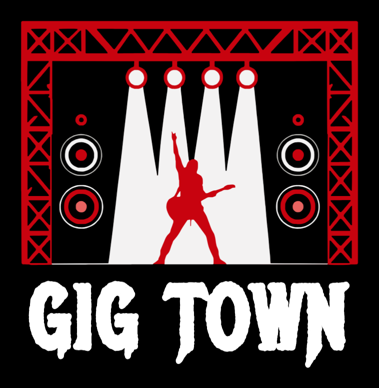
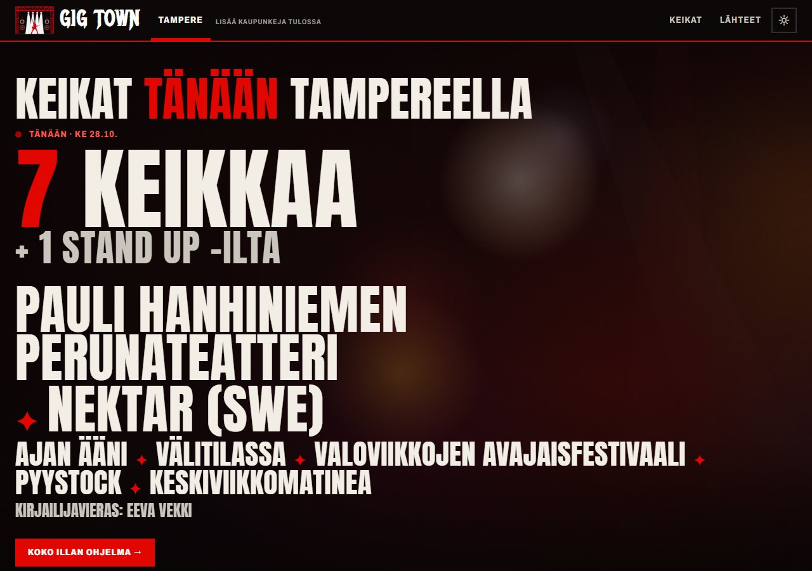
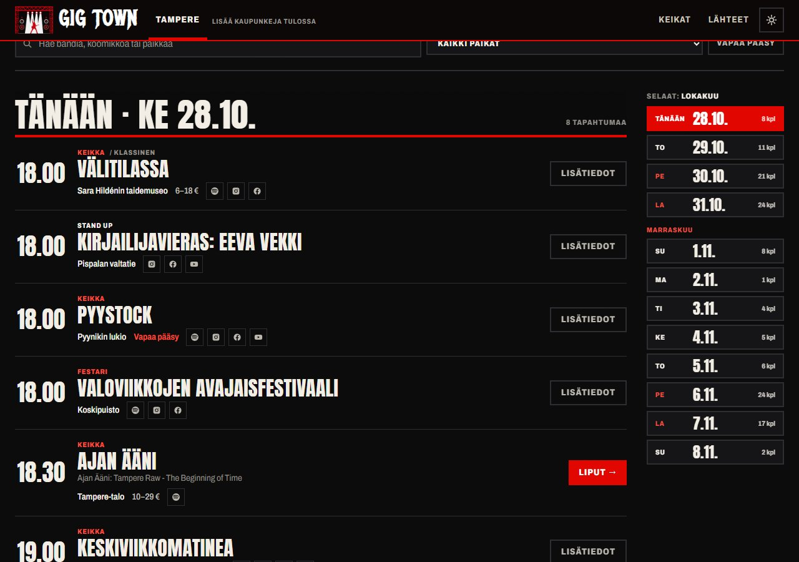
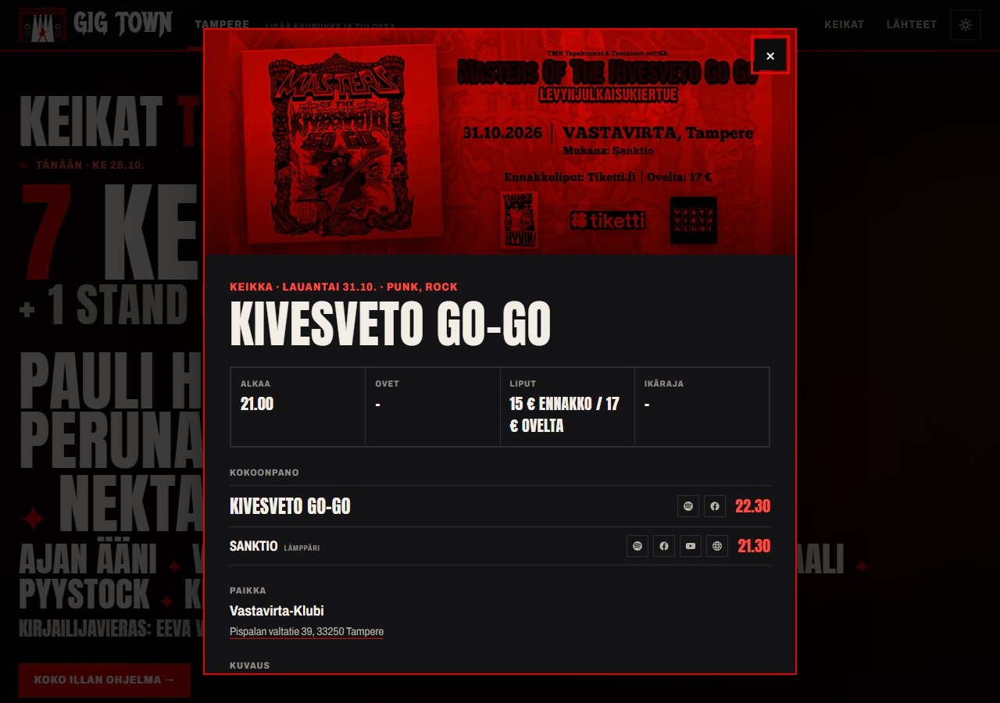
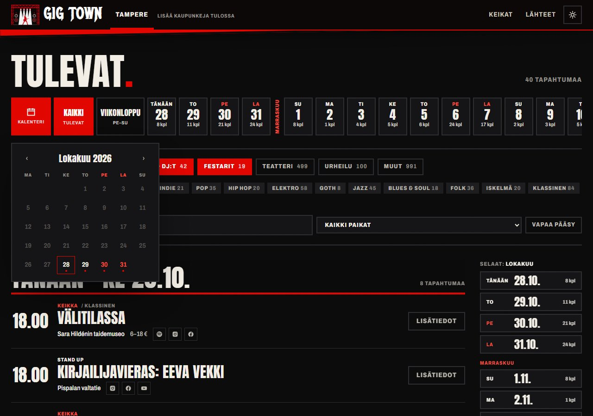
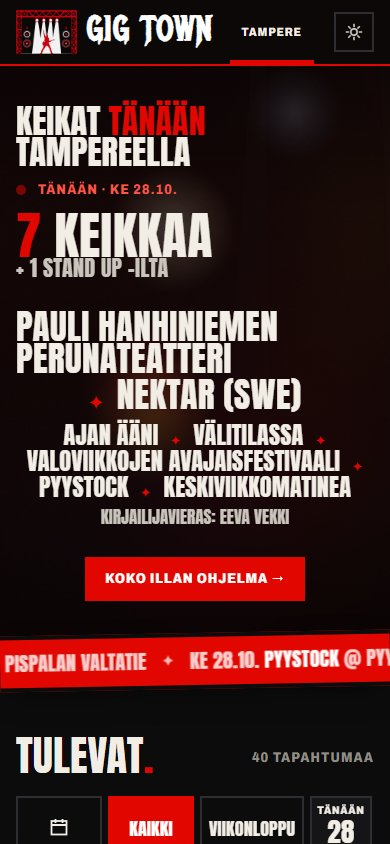
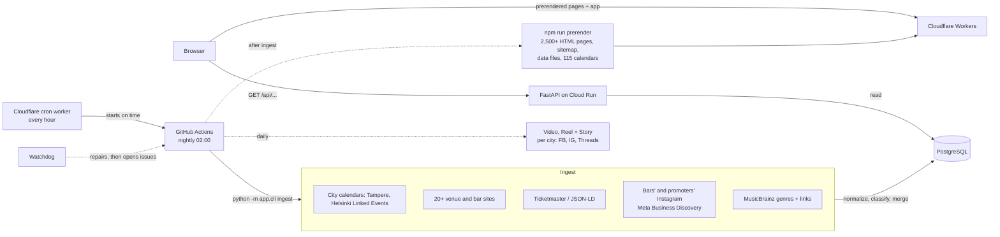

<div align="center">



### Every gig in Tampere and Helsinki on one page.

Concerts, club nights, stand-up and small bar gigs, collected every night by
bots from public calendars and venue websites, merged, sorted by genre and
shown by date: line-ups, set times, doors, prices and ticket links.

**Live: [gigtown.fi](https://gigtown.fi) · [Helsinki](https://gigtown.fi/helsinki)**

Tampere: [Instagram](https://www.instagram.com/gigtown_tampere/) · [Facebook](https://www.facebook.com/profile.php?id=61595840954236) · Helsinki: [Instagram](https://www.instagram.com/gigtown_helsinki/) · [Facebook](https://www.facebook.com/profile.php?id=61596446194417)

[Features](#features) · [Sources](#sources) · [How it works](#architecture) · [Engineering decisions](#engineering-decisions) · [Source code](#source-code)


</div>

> **Lyhyesti suomeksi:** GigTown kokoaa kaikki Tampereen ja Helsingin keikat, klubit,
> stand up -illat ja tapahtumat yhdelle sivulle. Botit käyvät joka yö klo 2
> läpi kaupungin tapahtumakalenterin, yli 20 keikkapaikan sivut ja 16 baarin
> Instagram-postaukset, yhdistävät
> saman keikan eri lähteistä, tunnistavat lämppärit, soittoajat, ovien
> aukeamisen ja hinnat, hakevat bändeille genret ja Spotify-/somelinkit, julkaisevat
> illan keikat videona Instagramiin ja Facebookiin, ja rakentavat jokaiselle päivälle, paikalle ja tapahtumalle oman
> hakukoneystävällisen sivun ("Keikat tänään Tampereella"). Keikat saa myös
> tilattua puhelimen kalenteriin, joka päivittyy itsestään, ja isojen keikkojen
> lipunmyynnin alkamispäivät näkyvät kuukausia etukäteen.



## Why

Gigs in Tampere are spread over a dozen places: the city's event calendar,
three ticket shops and every venue's own website, and the small bar gigs
with free entry or door tickets are only on the venue's page or its Facebook
event. Finding out "what's on tonight" means opening ten tabs.

GigTown does that once a night, automatically, and shows the result as one
list you read by date, like a festival programme.

## Features

<table>
  <tr>
    <td width="50%"></td>
    <td width="50%"></td>
  </tr>
  <tr>
    <td><sub>The list: three nights at a time, date tags on the right follow the scroll</sub></td>
    <td><sub>One gig: line-up with set times, prices, links for every act</sub></td>
  </tr>
  <tr>
    <td></td>
    <td align="center"></td>
  </tr>
  <tr>
    <td><sub>Month calendar for any night further ahead</sub></td>
    <td><sub>On a phone</sub></td>
  </tr>
</table>

- **Tonight as a festival poster.** The front page sets tonight's acts in
  poster type, the biggest names first, over a living background: a thin
  stage curtain with flickering lights, moving spotlights and a cloth that
  shivers on the kick drum (pure CSS, stops under `prefers-reduced-motion`).
- **Read by night.** A night runs 06:00–06:00, so a 00:30 set belongs to
  Friday night. "Lataa lisää" loads one more night at a time, date
  tags on the right list the nights on the page and follow your scrolling, a strip shows the next 60 nights
  with event counts, and a month calendar reaches any date beyond that.
- **Line-ups that make sense.** "Kivesveto Go-Go (22.30), Sanktio (21.30)"
  becomes a headliner and a support act with set times, latest set first.
  Doors ("Ovet klo 19:00"), advance and door prices ("15 € / 17 €") and age
  limits ("K-18") are read from the listings.
- **Sorting.** Gigs, stand-up, club nights and festivals; 15 genres from metal and punk to jazz, folk, iskelmä
  and jam nights; a "Vapaa pääsy" chip with the number of free-entry events; venue and free-text search.
- **Links for every act and event.** Spotify, Instagram, Facebook, TikTok,
  YouTube, Bandcamp and home page for each performer (from MusicBrainz), a
  "search on Spotify" fallback, and the organiser's social media for every
  event.
- **Every source shown.** Each event lists where it was found
  (*Vastavirta-Klubi* and *Tampereen tapahtumakalenteri (Tiketti)*), and the
  footer shows when each bot last ran.
- **Found by Google.** Every night, venue, genre, event type and event has
  its own Finnish URL (`/tampere/tanaan`, `/tampere/genret/metalli`,
  `/tampere/tapahtuma/kivesveto-go-go-vastavirta-klubi-31-10-2026-4`), a
  prerendered HTML page with its own title and description, schema.org
  `MusicEvent` data for Google's event search, and a sitemap.
- **Cancelled, sold out, few tickets left.** The bots read "peruttu",
  "loppuunmyyty" and "viimeiset liput" from every source (and check the
  venues again every night); cancelled and sold-out gigs get a worn red
  rubber stamp, nearly sold-out ones a "Liput vähissä" tag.
- **In your calendar.** Every event has "Lisää kalenteriin" (an `.ics`
  file for the phone's calendar) and a Google Calendar button, and the
  gigs can be subscribed to as calendars that update themselves:
  everything (`webcal://gigtown.fi/tampere.ics`), free entry only, or one
  venue or genre (115 calendars, rebuilt every night as static files, so
  a phone checking for changes never reaches the backend).
- **Daily social video.** Every day a bot films tonight's gigs over
  the stage curtain into a 9:16 video (Playwright + ffmpeg, frame by frame)
  and posts it to [Instagram](https://www.instagram.com/gigtown_tampere/) and [Facebook](https://www.facebook.com/profile.php?id=61595840954236) through Meta's
  Graph API as a Reel and a Story, with the night's best-known act from
  Deezer in the caption. Mondays add a feed image of the week's biggest gigs,
  Fridays one of the weekend's (posted once the night's bots have run), and
  the bot deletes its own week-old posts so the profile stays current.
- **Runs on time and checks itself.** GitHub's own schedules can start hours
  late, so a Cloudflare cron worker starts every workflow on the minute. A
  watchdog then checks that the day's posts really went out and the data on
  the site is fresh; what is missing it first repairs (posts again, runs the
  bots again), and only what is still wrong after that becomes a GitHub
  issue, which closes itself once the problem is gone. It also warns three
  weeks before the Meta key expires.
- **Follow along.** GigTown's Instagram and Facebook are in the header, the
  footer and a red banner that beats like a heart (and stays still for
  people who ask their device for less motion), and in the schema.org
  `Organization` data every page carries.
- **Suomeksi ja englanniksi.** A flag switch in the header turns the whole
  site into English; pages for search engines stay Finnish.
- **Fast and free to run.** The nightly build writes each night's events
  as static files next to the site, so visitors read Cloudflare's edge
  cache and never the database (which is written once a week and read once
  a night).
- **Two cities, kept apart.** Tampere and Helsinki each have their own
  bots, venue list, pages (`/helsinki/tanaan`), calendars and social
  channels. A source that serves several cities stamps each event with its
  own city, and a gig is filed under a city only when the city is certain.
  A new city is one entry in `app/cities.py`, its sources and one line in
  the social channels list.
- **Ticket sales opening.** A "Lipunmyynti alkaa" list shows big gigs months
  ahead with the day and hour their ticket sale opens ("to 26.11. klo 9"),
  read from the promoters' and ticket shops' Instagram posts (Business
  Discovery API), the city calendar and Ticketmaster. Shows sold together are
  one line.
- **Ticket clicks without cookies.** Clicks on ticket links are counted per
  day, event, list and ticket shop, with no cookie and no IP stored; a report
  gives the numbers to show ticket shops for affiliate deals.
- **Missing a venue?** A field in the footer takes suggestions without any
  personal data; a weekly issue lists the new ones.
- **Social posts per city.** Daily Reel and Story, a Monday week image and a
  Friday weekend post go to each city's own Facebook, Instagram and Threads
  (TikTok as a draft).
- **Smooth on phones.** The stage, banner and ticker animate on the graphics
  card only and pause when off screen.
- **Rock look.** Black and signal red, Anton poster type, white metal
  lettering in the logo, film grain, duotone event images. A light "paper
  poster" theme too. No sideways scrolling on phones.

## Sources

| Source | What it gives | How it is read |
|---|---|---|
| **Tampereen tapahtumakalenteri** | The backbone: ~2,000 upcoming events in Tampere, including the city's imports from **Lippu.fi, Tiketti and Ticketmaster**, with prices, ticket links and organisers' social media | The calendar's public JSON API |
| **Vastavirta-Klubi** | Small and free gigs with set times, room, advance/door prices, Facebook events | HTML |
| **G Livelab** | Every gig with start time, image and sold-out flag | HTML |
| **Tullikamari** (Klubi and Pakkahuone) | Set times, doors, age limit, door price, club nights | HTML |
| **Kulttuuritalo Telakka** | Gigs, jazz club, talks and dances | Hand-written paragraphs |
| **Katubaari Axu** | Small acoustic gigs not sold anywhere else | Month list |
| **Artturi 9** | The "A9 Live" list with Eventim Light ticket links | HTML |
| **Bar Ihku** | Star artists, party bands and DJ nights, showtimes and Ticketmaster links | Programme + ticket-shop JSON |
| **O'Connell's** | Improv, comedy, gigs, quizzes (not the TV sports) | HTML |
| **Bar Kotelo** | Rock and metal gigs with full line-ups and ticket prices | HTML boxes |
| **Pethaus** | Pispala's experimental and jazz nights (cafés and podcasts left out, a jam after a café kept) | Dated lines |
| **Pub Kujakolli** | Free Friday gigs at 22:00 | Dated lines |
| **Tampere-talo** | Concerts and stand-up (exhibitions and talks left out) | The venue's public event feed |
| **Kulttuurikeskus Maanalainen** | The month's gigs with prices; weekend showtime 21.30 | Dated lines |
| **Ravintola Suoma** | Gigs and pikkujoulu shows with times (menus and holidays left out) | Dated lines |
| **Ruby & Fellas** | The month's bands (the monthly page is found from the home page) | Dated lines |
| **Kulttuuriravintola Railo** | Monthly gig nights in Nekala | Dated lines |
| **Ilona** | Bands on Friday and Saturday nights ("13.-14.11." gives both nights) | Dated lines |
| **Pub Simon** | Friday live-music afterworks (Tuesday quizzes left out) | Squarespace events page |
| **Jams** (Jerun Piilopaikka on Mondays and Wednesdays, Pub Kujakolli on the first Sunday of the month) | Recurring jam nights, listed only while the venue's page still announces them | The venue's own page |
| **F54** (formerly Fame Club) | Club gigs | schema.org JSON-LD |
| **Rymy-Eetu** | Party bands and live band karaoke (its malformed dates are read as meant) | schema.org JSON-LD |
| **Instagram** (16 bars without a programme page: Pub Armo, Paapan kapakka, TTT-Klubi, Onda, Huurupiilo, Amadeus, Sherlock Holmes, …) | Gigs the bars announce in their post text: weekly and monthly programme lines ("Pe 13.11. Act", "16.10. Act kello 20"), and posts like "Tänään lavalla Act"; quizzes, bingo, screenings, drink offers and opening hours left out | Meta's official Business Discovery API, nightly and at 16:07 |
| **Ticketmaster Discovery API** | Start times, price ranges, genres | Official API (optional key) |
| **Any venue with schema.org events** | `MusicEvent`, `ComedyEvent`, … from the page | `JSONLD_URLS` |
| **MusicBrainz** | Genres and Spotify/social links for performers | Official API, cached per artist |
| **Deezer** | The night's best-known act for the social video | Public API |

**Checked, but not possible:** Facebook has no public event search any more
and does not allow scraping; Bandsintown, Lippu.fi, Ticketmaster.fi and
meteli.net block automated requests. Ruma's and Gong's domains are gone,
Lepakkomies' domain is an unrelated blog, Yo-talo is closed for renovation.
John Scott's and Atmos load their programme with JavaScript (Jerun
Piilopaikka's weekly jams are read from its page), and many small bars post
their gigs only on social media. Instagram posts are read through Meta's
official API (see the table), but only their text: a programme posted as a
picture gives nothing. Facebook pages cannot be read without Meta's business
verification. GigTown does not try to get around any of this: those events
reach it through the city calendar and the ticket shops, and every listed
venue (65 in Tampere, closed ones like Olympia and Yo-talo excluded) is in
the venue registry, with the other names sources use for it ("Ravintola
Kaijakka", "Irish Bar O'Connell's", Fame Club for F54), so its gigs get the
right name and type.

### The crawling rules

`app/services/http.py` is the only way the bots fetch anything: an honest
User-Agent that links to this repository, robots.txt obeyed for every
website, at least a second between requests to the same host (two for
MusicBrainz), and a 403/429 or bot challenge reported as an error for that
source and never retried. Documented public APIs (MusicBrainz, Ticketmaster)
skip the robots.txt check, which is written for crawlers, but keep the rate
limit.

## Architecture



The pipeline for every event a source returns
(`app/services/ingest.py`):

1. **Normalize.** Map the venue to a known place
   (`venues.py`), classify type and genres
   (`classify.py`), split the line-up and read
   doors, age limit and prices (`parse.py`).
2. **Match.** The same listing as before? Otherwise the same city, venue and
   night with a similar headliner, and not a second show of the same day
   from the same source? Otherwise a new event.
3. **Store.** The source's cleaned copy is kept in `event_sources.data`.
4. **Merge.** The event is rebuilt from all its fresh copies: venue sites
   win for line-up and times, ticket shops fill in prices, a real ticket shop
   beats a Facebook link, and of two copies from one source the newest
   decides.

## Engineering decisions

**The city calendar as the backbone.** Tampere's calendar already imports
Lippu.fi, Tiketti and Ticketmaster through a public API meant for reuse. One
request replaces three ticket shops that would block a crawler; venue
scrapers are only needed for what ticket shops never see.

**Keep every source's copy.** Rebuilding the merged event from each source's
stored copy makes merging deterministic and debuggable: running the same
ingest twice changes nothing, and a cancelled event simply drops out once no
source lists it.

**Match across sources, not within one.** A venue prints the set time
(21.00), the calendar the evening's start (19.00): the same gig. A theatre
lists a matinee and an evening show: two events. Times that differ by more
than 90 minutes keep events apart only when they come from the same source.

**Crawl in GitHub Actions, not in the API.** An ingest takes minutes (a
7 MB calendar, two seconds per MusicBrainz request), so the nightly workflow
writes to the database directly and the API stays fast and read-only.

**One failing source never stops the rest.** Each source runs in its own
transaction with its own log row; a changed page layout shows up as "no gigs
found" for that source in the footer.

**Prerendered pages from the same code as the app.** Titles, descriptions,
headings and schema.org data come from one module
(`frontend/src/lib/seo.ts`) used both in the
browser and by the nightly prerender, so what Google reads and what visitors
see never drift apart. Pages are written as `tampere/tanaan.html`, which
Cloudflare serves at `/tampere/tanaan` without a trailing-slash redirect.

**Venue names as data, not as matching rules.** Each venue has one key and
the other names sources use for it. When two names turn out to be one place
(Fame Club became F54), adding the alias is enough: the next run moves every
copy to the event already listed under the new key, and housekeeping removes
the leftovers under the old one. A stage that is really a different kind of
place gets its own entry (the Komediateatteri's Ravintolateatteri is a
stand-up stage, not a theatre, like TTT-Klubi beside TTT).

**Reading Instagram captions conservatively.** A bar's post is only a gig
when it has a date or a day word and an act's name next to it; a weekly list
gives one gig per dated line, its first sentence as the name and the
earliest band's time as the start. Every rule change is checked against all
the accounts' recent posts before and after, and a change that adds wrong
gigs elsewhere is dropped.

**A clock that does not run late, and a watchdog that repairs first.**
Scheduled workflows on GitHub can start hours late or not at all, so a
Cloudflare worker (one hourly cron trigger, the free plan's limit is five)
dispatches each job at its time; every workflow still checks whether today's
run already happened, so an extra start never posts twice. A post counts as
done only when its "film and post" step really ran, not when the run ended
green.

**Untrusted input stays data.** Every scraped link must be `http(s)`, so a
`javascript:` ticket link from a source page can never reach the
prerendered pages; React escapes the rest. The site sends HSTS, a CSP that
forbids plugins, framing and foreign form targets, and a Permissions-Policy;
the ingest endpoint compares its token in constant time.

**Strict genre matching.** A MusicBrainz artist is accepted only on an exact
name match, preferring the country in the gig title ("(SWE)") or Finland;
ambiguous names are skipped rather than guessed.

## Docker

Both halves of GigTown are built as small, production-style images, and the
same backend container runs on a laptop and in the cloud.

**Backend** (`Dockerfile`): a multi-stage build. Poetry resolves the
dependencies in a build stage; the runtime stage on `python:3.13-slim` gets
only the virtualenv and the code, no Poetry, no compilers. It runs as an
unprivileged user (uid 10001). The entrypoint applies the Alembic migrations
and starts Uvicorn on `$PORT`, so Cloud Run, App Runner or plain Docker can
run it unchanged; `RUN_MIGRATIONS=false` leaves migrations to a separate job
when there are many instances. Production is this image on Google Cloud Run,
built from the Dockerfile on every deploy.

**Frontend** (`frontend/Dockerfile`): Node 22 builds the React app, and
`nginx:1.27-alpine` serves the static files with long-lived caching for
hashed assets, an SPA fallback and security headers. The backend address is
not baked in: a start-up script writes it from `API_URL` into `/config.js`
(and refuses values with quotes or `<`), so **one image works in every
environment**. The live site is served by Cloudflare Workers; the image is
the portable way to run the frontend anywhere else, Cloud Run included (it
listens on `$PORT`, default 8080).

**Local stack** (`docker-compose.yml`): PostgreSQL 16 with a health check,
and the API container starting only once the database is ready:

```bash
cp .env.example .env
docker compose up --build                          # API on http://localhost:8000
docker compose exec api python -m app.cli ingest   # fill the database
```

**In CI:** after the tests, both images are built on every push to main and
every pull request, and the frontend image is started and checked: it must
serve the app and write the `API_URL` it was given into `/config.js`.

## Tech stack

| | |
|---|---|
| **Backend** | Python 3.13, FastAPI, Pydantic, SQLAlchemy 2, Alembic, PostgreSQL (SQLite for local work), httpx, selectolax (lexbor), Poetry, Ruff, pytest |
| **Frontend** | React 19, TypeScript (strict), Vite, Tailwind CSS 4, TanStack Query, openapi-typescript (API types generated from the backend schema), Vitest, Oxlint, Prettier |
| **Automation** | GitHub Actions: CI (lint, types, tests, migrations on PostgreSQL, Docker builds) and the nightly ingest at 02:00 Finnish time |
| **Hosting** | Docker, Google Cloud Run (backend), Neon PostgreSQL, Cloudflare Workers (frontend); designed to fit their free tiers next to [BullBearScope](https://github.com/EliasNiskanen/BullBearScope), whose architecture GigTown follows |

**Tests:** 113 backend tests run the parsers against saved copies of the real
pages (`tests/fixtures/`, with the year replaced so the gigs are always in
the future) and real Instagram captions, plus the classifier, venue names,
merging, links and the API; 18 frontend tests cover dates, URLs, page
titles, formatting and the iCal output.

## API

| Method | Endpoint | Description |
|---|---|---|
| GET | `/api/events?city=&date_from=&date_to=&category=&genre=&venue=&q=&free=` | Upcoming events, oldest first |
| GET | `/api/events/{id}` | One event with line-up, links and sources |
| GET | `/api/facets?city=&date_from=&date_to=&category=` | Counts for the filters and events per night |
| GET | `/api/cities` | The city tabs |
| GET | `/api/sources` | Every source, its last run and how many events it lists |
| POST | `/api/ingest?source=` | Run the bots now (requires `X-Ingest-Token`) |

Interactive docs at `/docs`.

## Source code

The code is kept in a private repository while the service runs. It is
available for review on request: **info@gigtown.fi**.

It has 113 backend tests (pytest, against saved copies of every source page)
and 18 frontend tests (Vitest), linted with Ruff and oxlint, and every push runs
CI, migrations against real PostgreSQL and both Docker builds before deploying.

## Project layout

```
app/                     FastAPI backend
  cities.py              the cities and their names ("Tampereella")
  routers/               /api/events, /facets, /cities, /sources, /ingest
  services/
    http.py              polite fetcher (robots.txt, rate limit)
    sources/             one module per source
    parse.py             dates, doors, prices, age limits, line-ups
    classify.py          event type and genres
    links.py             social and streaming links by service
    venues.py            known venues per city
    ingest.py            normalize, match, merge, run
    musicbrainz.py       performer genres and links
  cli.py                 python -m app.cli ingest
alembic/                 migrations
tests/                   pytest suite and saved pages
frontend/
  src/components/        stage curtain, poster hero, date strip, calendars, list, dialog
  src/lib/               URL state, dates, SEO titles and schema.org, formatting
  src/prerender/         nightly static pages, sitemap, data files and calendars
  scripts/social/        the daily video, Reels, Stories and feed images
cron/                    Cloudflare worker that starts the workflows on time
.claude/skills/          how to add a source, a city, posts, the look, reuse the architecture
docs/logo/               the logo as PNG and SVG
.github/workflows/       CI, nightly ingest, deploys, social posts, watchdog
```

## Roadmap

- Turku, Oulu and other cities
- Affiliate deals with ticket shops, based on the click counts
- The same architecture for other listing sites
- More small venues as they publish their programmes on the web

<sub>Logo artwork by Elias Niskanen. The logo lettering uses
[Metal Mania](https://fonts.google.com/specimen/Metal+Mania) (SIL Open Font
License).</sub>
